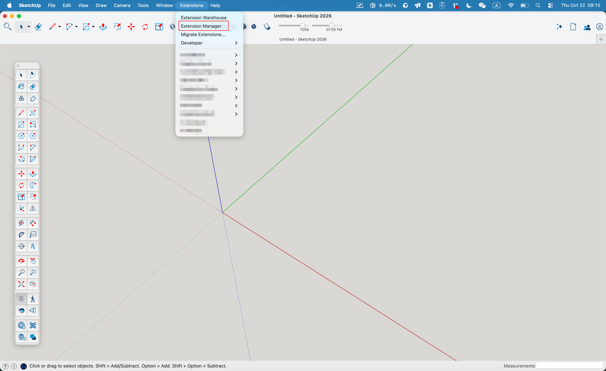
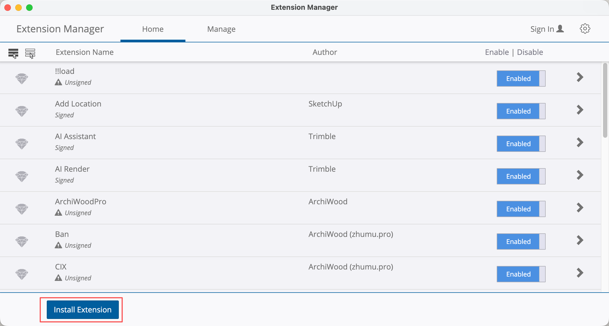
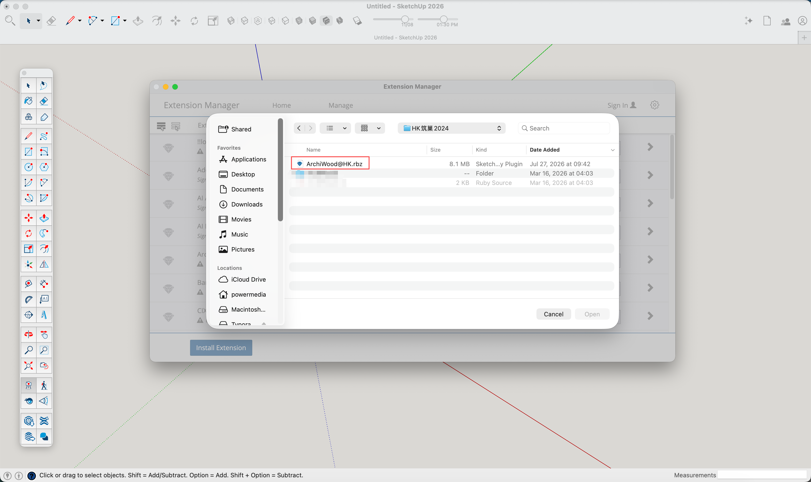
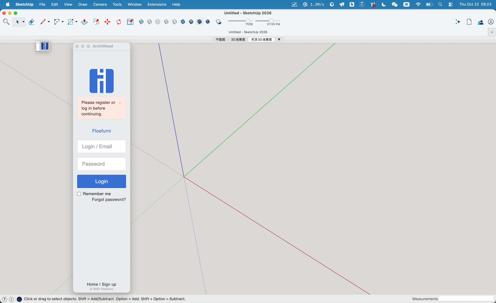
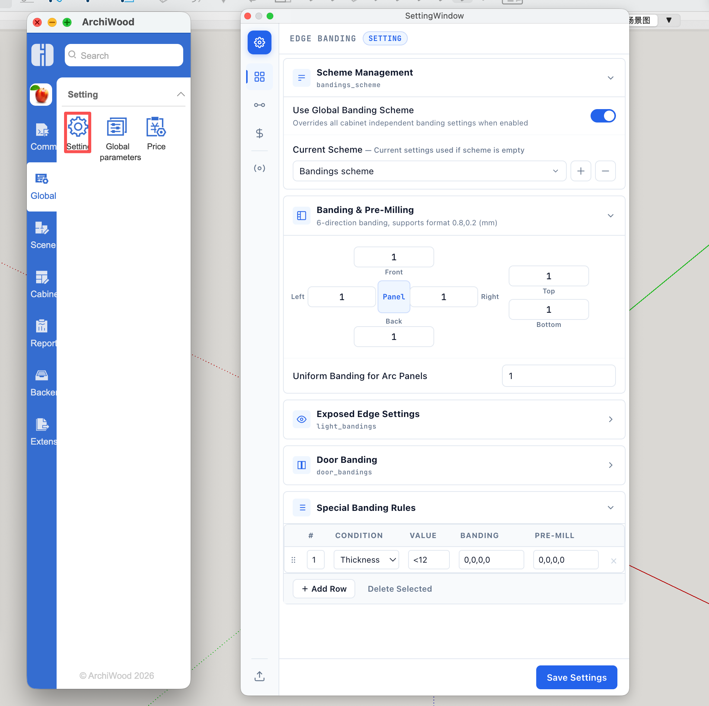
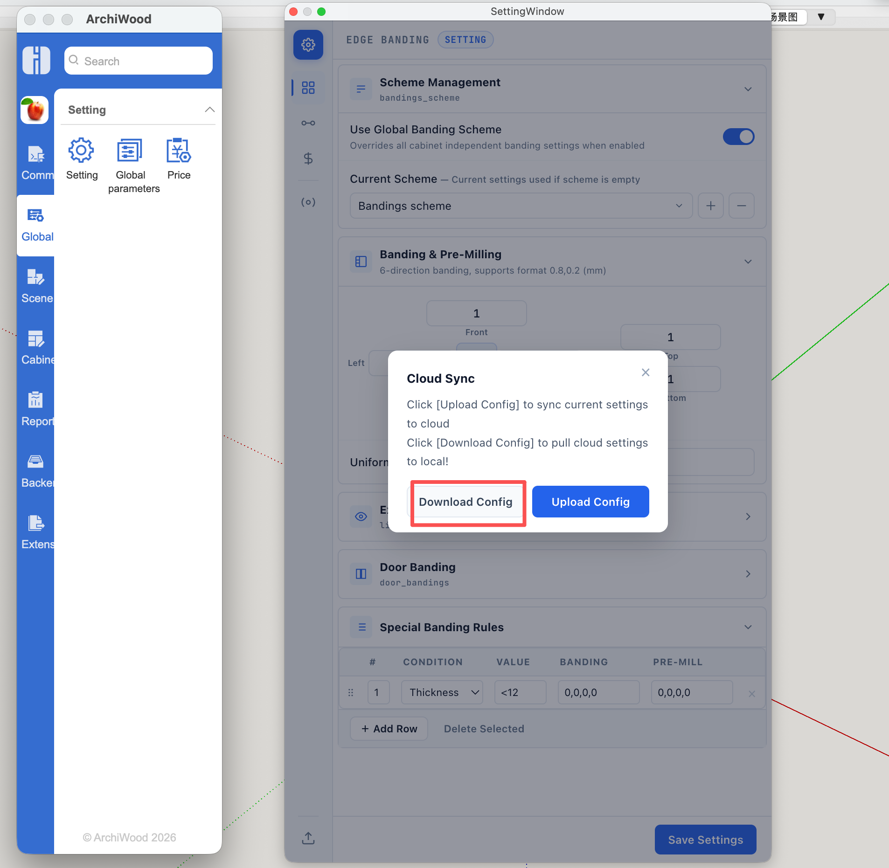
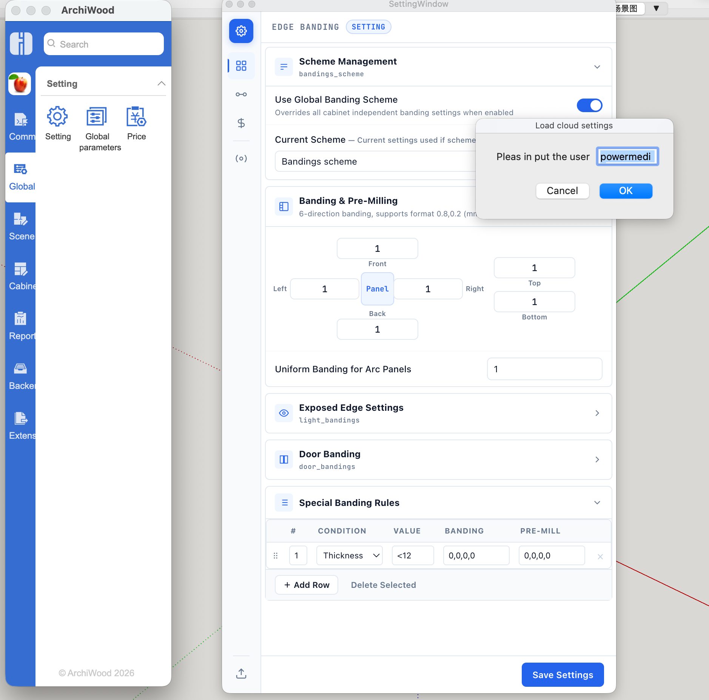

# Getting Started

How to install ArchiWood

1、open the Sketchup extension manager. and click install Extension button

2、Click the Install Extension

3、choose our plugin file(.rbz)

4、Enter your account  and log in. Once the installation is complete

5、Open the global settings window,click the Sync button

6、Click the download button

7、If this is the first time you’re using our software, simply enter the admin account “powermedia”. If you have previously installed it on another computer and synchronized your data back-end, simply enter your previous account.

click the ok button ,to download the settings data,if sucessfull you need to restart sketchup

